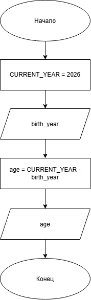

# Индивидуальный вариант к работе 6
## Условие задачи
Написать программу, которая на основе введенного года рождения вычисляет полный возраст в годах и выводит результат в текстовой форме. (Например: 5 лет, 21 год).

## 1. Алгоритм и блок-схема

### Алгоритм
1. **Начало**
2. Объявить константы:
   - `CURRENT_YEAR` = 2026 — текущий год.
3. Задать исходные данные:
   - `birth_year` — год рождения.
4. Вычислить возраст:
   - `age` = `CURRENT_YEAR` - `birth_year`
5. Вывести результаты расчетов с подстановкой всех значений в текст.
6. **Конец**

### Блок-схема


## 2. Реализация программы

```C
#include <stdio.h>
#include <locale.h>

#define CURRENT_YEAR 2026

int main()
{
    setlocale(LC_CTYPE, "RUS.UTF-8");

    int birth_year;
    puts("Введите год рождения: ");
    scanf("%d", &birth_year);
    int age = CURRENT_YEAR - birth_year;
    printf("Полный возраст: %d ", age);

    if (age % 10 == 1)
    {
        puts("год");
    }
    else if (age % 10 > 1 && age % 10 < 5)
    {
        puts("года");
    }
    else
    {
        puts("лет");
    }

    return 0;
}
```
## 3. Результаты работы программы

Полный возраст: 22 года

## 4. Информация о разработчике

бТИИ-261 Иголкин Максим Александрович
